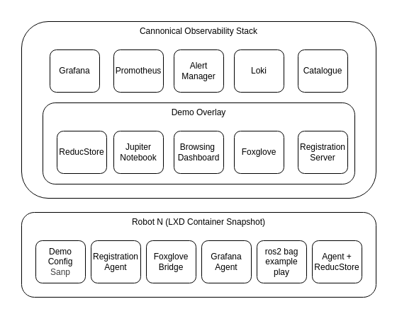

# Architecture

This demo shows how a ROS 2 robot can stream sensor and telemetry data
into [ReductStore](https://www.reduct.store) via
[ReductBridge](https://github.com/reductstore/reduct-bridge), and how the
edge-side store then replicates a filtered subset to a cloud aggregator
for visualization in Grafana and Foxglove.



## Data flow

```
  MCAP file  ──►  ros2 bag play  ──►  ROS 2 topics
                                         │
                                         ▼
                                   reduct-bridge  (ROS 2 input)
                                         │  (HTTP, batched)
                                         ▼
                                    ReductStore edge  (bucket: robot)
                                         │
                                         │  replication tasks (filtered)
                                         ▼
                                    ReductStore cloud (bucket: robot)
                                         │
                          ┌──────────────┴──────────────┐
                          ▼                             ▼
                       Grafana                       Foxglove
```

All of the above runs as containers in a single `docker compose`.

## Services

| Service     | Role                                                                           | URL (via Traefik)            |
| ----------- | ------------------------------------------------------------------------------ | ---------------------------- |
| `robot`     | `ros2 bag play` + `reduct-bridge` in one container (simulated robot)           | —                            |
| `edge`      | ReductStore on the "robot" — ingest target for the bridge                      | http://edge.reduct.demo      |
| `cloud`     | ReductStore aggregator — destination of replication tasks                      | http://cloud.reduct.demo     |
| `grafana`   | Dashboards, pre-provisioned with ReductStore Cloud as the default datasource   | http://grafana.reduct.demo   |
| `foxglove`  | Browser-based ROS data visualization                                           | http://foxglove.reduct.demo  |
| `traefik`   | Reverse proxy for the demo hostnames                                           | http://traefik.reduct.demo   |

## Replication tasks

The `edge` store is configured with three replication tasks to `cloud`:

- **R1 — `robot-image-1fps`**: downsample the `image` entry to 1 fps so that
  the cloud keeps a lightweight visual timeline of every run without copying
  the full-rate camera stream.
- **R2 — `robot-medium`**: replicate records tagged with medium-severity
  telemetry labels (warning-level events, elevated CPU temp, low battery,
  close obstacles, etc.). No surrounding context is included.
- **R3 — `robot-high`**: replicate high-severity records with **5 minutes
  of pre-context** so the cloud gets the full lead-up to every critical
  event.

Replication filters are expressed with ReductStore's query language.
The rules live as env vars on the `edge` service in `docker-compose.yml`.

## ReductBridge topic configuration

The bridge subscribes to the topics defined in `config/reduct-bridge.toml`.
By default it captures:

- `/camera/image_raw/compressed_restamped` → entry `image`
- `/odom` → entry `odom`
- `/tf` → entry `tf`
- `/rosout` → entry `rosout`

Add or remove `[[inputs.ros2.robot.topics]]` blocks to change the set.

## Cloud deployment as a next step

The Docker Compose path above is the main demo. Deploying ReductStore
into a Kubernetes cluster with COS Lite (Juju charm, snaps on the robot,
registration server, etc.) is documented as an **optional** next step in
[`cloud-deployment.md`](cloud-deployment.md).
